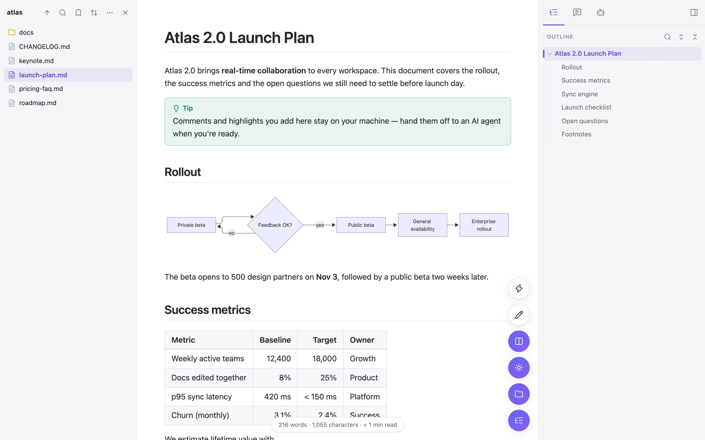

# MarkCraft

**A free, open-source Markdown viewer, editor and reviewer for Chrome.** Open any `.md` file — local or remote — and get a polished reading view with diagrams, math, outline, annotations, live reload, WYSIWYG editing, presentation mode, mind maps and Word/HTML/PDF export. Everything runs locally; nothing is collected.

[Website](https://markcraft.cc) · [简体中文说明](README.zh-CN.md) · [Issues](https://github.com/zhangweiii/markcraft/issues)



## Features

**Reading**
- Takes over raw `.md` / `.markdown` / `.mdx` / … files on `file://` and http(s) (e.g. raw.githubusercontent.com); `.txt` optional
- GitHub Flavored Markdown, highlight.js (12 syntax themes), KaTeX, footnotes, GitHub alerts, front-matter metadata card
- Diagrams: Mermaid, Graphviz, WaveDrom (local), PlantUML (opt-in server with explicit consent) — fullscreen zoom/pan and SVG/PNG/JPEG download
- Plugins: emoji, `==mark==`, `++ins++`, `~sub~`, `^sup^`, definition lists, abbreviations, `:::` containers, typographer, advanced tables, Mintlify components (Card, Tabs, Steps, Accordion, CodeGroup, callouts…)
- Outline with scroll-spy, search, expand/collapse; find in page (case / word / regex); image lightbox; reading progress, word count, sticky table headers, RTL auto-direction; light/dark/sepia themes, centered or full-width layout

**Files**
- Folder browser with sort, group, filter, bookmarks and full-text search in folder
- Live auto-refresh with a +/− diff banner (accept / dismiss) when files change on disk
- Drag & drop, recent documents in the popup

**Editing**
- Read / WYSIWYG (Milkdown) / Source modes, Markdown paste, save (⌘S) back to the file
- Saves straight back to the file with Chrome's File System Access API: files opened from a folder or the file picker save directly; a local `file://` page asks once for the file and remembers it

**Review & AI**
- Highlight (4 colors), underline and comment; annotations persist and appear in print and exports
- Hand off review comments as a prompt, or ask the built-in agent to edit the document and review the diff before applying
- The built-in agent uses the AI provider you configure in Settings → AI Provider (OpenAI-compatible or Anthropic API format, your own API key, stored only on this device); it is unavailable until one is set up

**Present & export**
- Presentation mode (themes, colors, background image, speaker notes, auto-play, touch)
- Interactive mind map (SVG/PNG/JPEG)
- Export to Word (.docx), HTML, print/PDF; copy as rich text

**Settings** — General, Appearance, Plugins, Presentation, PlantUML, customizable Shortcuts, Import/Export. Interface in English and 简体中文.

## Install (from source)

```sh
git clone https://github.com/zhangweiii/markcraft.git
cd markcraft
npm install
npm run build        # outputs dist/
```

1. Open `chrome://extensions`, enable **Developer mode**, click **Load unpacked** and pick `dist/`.
2. In MarkCraft's **Details**, enable **Allow access to file URLs** for local files.
`npm run package` builds `markcraft.zip` for the Chrome Web Store and refuses to package private keys, source maps or local config files.

## Development

```sh
npm run watch                         # incremental build
npx playwright install chromium       # once
npm test                              # end-to-end tests (Playwright, test/fixtures)
```

| Path | What |
|---|---|
| `src/detect.js` | content script: detects raw Markdown and opens the viewer |
| `src/viewer/` | the viewer app (rendering, editor, panels, exports, presentation, mind map) |
| `src/shared/` | settings + schema-driven settings UI, IndexedDB, i18n, icons, design tokens |
| `src/popup.js`, `src/options.js` | toolbar popup and options page |
| `scripts/test.mjs` | end-to-end test suite |
| `site/` | website ([markcraft.cc](https://markcraft.cc)), deployed to GitHub Pages; `npm run screenshots` refreshes its images |

## Privacy

No analytics, no telemetry, no accounts. Files never leave your machine. The only optional network features are PlantUML rendering (off until you consent) and loading images/links referenced by your documents.

## Credits

Built on [marked](https://github.com/markedjs/marked), [highlight.js](https://highlightjs.org/), [KaTeX](https://katex.org/), [Mermaid](https://mermaid.js.org/), [Viz.js](https://github.com/mdaines/viz-js), [WaveDrom](https://wavedrom.com/), [Milkdown](https://milkdown.dev/), [markmap](https://markmap.js.org/), [docx](https://docx.js.org/), [DOMPurify](https://github.com/cure53/DOMPurify), [jsdiff](https://github.com/kpdecker/jsdiff) and [Lucide](https://lucide.dev/) icons.

## License

[MIT](LICENSE)
