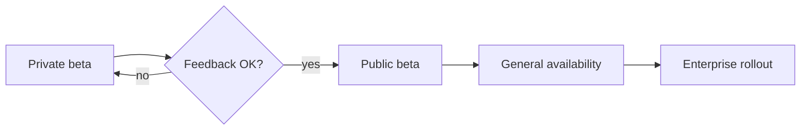

# Atlas 2.0 Launch Plan

Atlas 2.0 brings **real-time collaboration** to every workspace. This document covers the rollout, the success metrics and the open questions we still need to settle before launch day.

> [!TIP]
> Comments and highlights you add here stay on your machine — hand them off to an AI agent when you're ready.

## Rollout



The beta opens to 500 design partners on **Nov 3**, followed by a public beta two weeks later.

## Success metrics

| Metric | Baseline | Target | Owner |
|:--|--:|--:|:--|
| Weekly active teams | 12,400 | 18,000 | Growth |
| Docs edited together | 8% | 25% | Product |
| p95 sync latency | 420 ms | < 150 ms | Platform |
| Churn (monthly) | 3.1% | 2.4% | Success |

We estimate lifetime value with

$$
\text{LTV} = \frac{\text{ARPU} \times \text{gross margin}}{\text{monthly churn}}
$$

so cutting churn from $3.1\%$ to $2.4\%$ lifts LTV by roughly **29%**.

## Sync engine

```ts sync/presence.ts
export function broadcastPresence(room: Room, user: User) {
  const payload = { id: user.id, cursor: user.cursor, ts: Date.now() };
  room.peers.forEach((peer) => peer.send('presence', payload));
}
```

## Launch checklist

- [x] Security review signed off
- [x] Pricing page copy approved
- [ ] Migration guide published
- [ ] Status page alerts configured

## Open questions

1. Should offline edits merge automatically or ask first?[^1]
2. Do we ship the ==presence avatars== in the beta, or hold them for GA?

[^1]: Design partners strongly preferred automatic merges in the last study.
