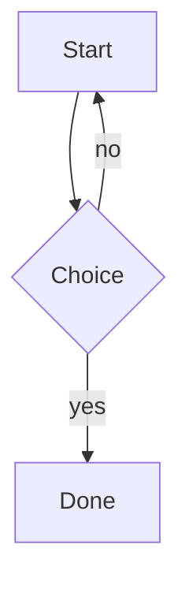
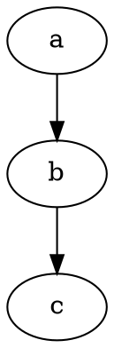

# MarkCraft Sample

Intro paragraph with **bold**, *italic*, ~~strike~~, `inline code`, a [link](https://example.com) and an autolink https://anthropic.com.

## Lists

- [ ] Unchecked task
- [x] Checked task
- Plain item
  1. Nested ordered
  2. Second

## Code

```js
function hello(name) {
  return `Hello, ${name}!`; // greet
}
```

## Table

| Name | Value |
|:-----|------:|
| alpha | 1 |
| beta | 2 |

## Math

Inline $E = mc^2$ and block:

$$
\int_0^1 x^2 \, dx = \frac{1}{3}
$$

## Diagram



## Alerts and footnotes

> [!NOTE]
> Useful information.

Here is a footnote reference.[^1]

[^1]: The footnote text.

## Links

See [other doc](sub/other.md) and .

### Deep heading

Final paragraph mentioning searchterm twice: searchterm.

## More diagrams



```wavedrom
{ signal: [ { name: "clk", wave: "p...." }, { name: "dat", wave: "x.34x", data: ["A", "B"] } ] }
```

```plantuml
Alice -> Bob: hello
```

مرحبا بالعالم، هذه فقرة باللغة العربية.

## Plugins

Water is H~2~O, area x^2^, ==marked==, ++inserted++ and :rocket: emoji. The HTML spec.

*[HTML]: Hyper Text Markup Language

Apple
: A fruit

::: tip Pro tip
Containers work.
:::

## Mintlify

<Note>Mintlify callout body.</Note>

<CardGroup cols={2}>
<Card title="First card" icon="rocket" href="https://example.com">Card body text.</Card>
<Card title="Second card">Another card.</Card>
</CardGroup>

<Tabs>
<Tab title="One">Tab one content.</Tab>
<Tab title="Two">Tab two content.</Tab>
</Tabs>

<Steps>
<Step title="Install">Run the installer.</Step>
<Step title="Use">Open a file.</Step>
</Steps>

<Accordion title="Question?">Answer inside accordion.</Accordion>

<CodeGroup>
```js app.js
console.log('a')
```
```py main.py
print('b')
```
</CodeGroup>

```mermaid
graph LR
  X --> Y --> Z((broken
```
