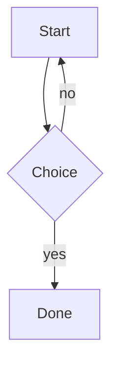

# MarkCraft Sample

Intro paragraph with **bold**, *italic*, ~~strike~~, `inline code`, a [link](https://example.com) and an autolink https://anthropic.com.

## Lists

- [ ] Unchecked task
- [x] Checked task
- Plain item
  1. Nested ordered
  2. Second

## Code

```js
function hello(name) {
  return `Hello, ${name}!`; // greet
}
```

## Table

| Name | Value |
|:-----|------:|
| alpha | 1 |
| beta | 2 |

## Math

Inline $E = mc^2$ and block:

$$
\int_0^1 x^2 \, dx = \frac{1}{3}
$$

## Diagram



## Alerts and footnotes

> [!NOTE]
> Useful information.

Here is a footnote reference.[^1]

[^1]: The footnote text.

## Links

See [other doc](sub/other.md) and .

### Deep heading

Final paragraph mentioning searchterm twice: searchterm.
